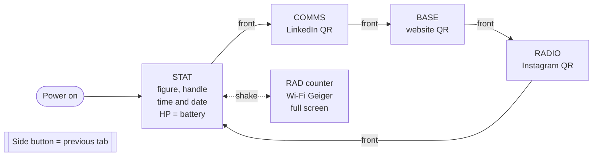
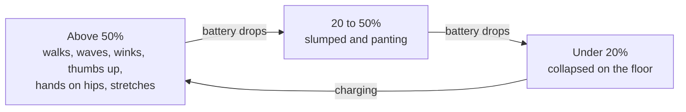

# Miniature Pip-Boy for M5Stack StickS3

A pocket Fallout-style **Pip-Boy** that runs on an [M5Stack StickS3](https://docs.m5stack.com/en/core/M5StickS3). A green CRT UI with tabs you flip through: a character on the STAT screen whose mood follows the battery, QR codes to your links, and a Wi-Fi "Geiger counter."

Built by **SuperDidZero**. The vault-dweller figure is my own cartoon avatar, left in so you get the same little guy; swap the links and handle for your own (see below).


*Screen previews rendered from the sketch: STAT with the time and date, STAT with no known Wi-Fi (handle shown big), the BASE tab with a working QR code to pcbuildpt.com, and the RAD counter you get by shaking it.*

## What it does

- **STAT** — a walking vault-dweller, your handle, and the time and date (day.month.year). HP = the real battery level along the bottom. He reacts to the battery:
  - above 50%: random idle poses (walks, stops, thumbs up with a wink, waves, hands on hips, stretches)
  - 20–50%: slumped and panting
  - under 20%: collapsed on the floor
- **COMMS / BASE / RADIO** — three QR codes (LinkedIn, website, Instagram), each playing a short public-domain tune when you open it.
- **RAD counter** (shake) — a full-screen Geiger counter driven by the strongest Wi-Fi signal around you (needle + clicks), plus a count of nearby networks.

### About the time

The StickS3 has no battery-backed clock, so it can't keep time while it's switched off. At every boot it tries your Wi-Fi once to fetch the time, then turns Wi-Fi off (it gives up after about 40 seconds so it can't drain the battery). If it got the time, STAT shows it until you switch off, even after you leave home. If there was no known Wi-Fi at boot, the time and date are left off and your handle is shown bigger in their place.

### LCD lettering

Every word and number is drawn as a segmented LCD display, like an old digital watch: 14-segment letters, and 7-segment numbers (clock, date, HP and the RAD readings) with the faint unlit segments shaded behind the digits. It's all drawn in code, no font files needed.

## Controls

- **Front button** — next tab
- **Side button** — previous tab
- **Shake** — full-screen RAD counter, shake again to go back

## How it fits together



The figure on STAT changes with the real battery level:



The RAD counter opens from any tab, not just STAT.

## Build it

1. Put `Pip_Boy.ino` and `sprites.h` together in a folder named `Pip_Boy`.
2. Install the **M5Unified** library (Arduino Library Manager). Nothing else is needed — the QR codes are drawn by M5GFX.
3. Board: **M5StickS3**.
4. Upload. If it won't connect, hold the side button until the green light blinks (download mode), pick the port, and upload again.

## Make it yours

Near the top of `Pip_Boy.ino`, change these to your own:

```c
const char* URL_INSTAGRAM = "https://instagram.com/YOUR_HANDLE";
const char* URL_LINKEDIN  = "https://linkedin.com/in/YOUR_LINKEDIN";
const char* URL_WEBSITE   = "https://YOUR-WEBSITE.example";
const char* HANDLE        = "@YOUR_HANDLE";
const char* WIFI_SSID     = "YOUR_WIFI_NAME";      // only used to fetch the time at boot
const char* WIFI_PASS     = "YOUR_WIFI_PASSWORD";
```

Use a 2.4 GHz network (the StickS3 can't join 5 GHz). Don't commit your real Wi-Fi password if you publish your copy.

To use your own character, replace the sprites in `sprites.h` (RGB565, byte-swapped for the panel, `0x1FF8` as the transparent colour).

## License

MIT. The figure art is my own; feel free to use the code, and swap in your own character if you'd rather not ship mine.
